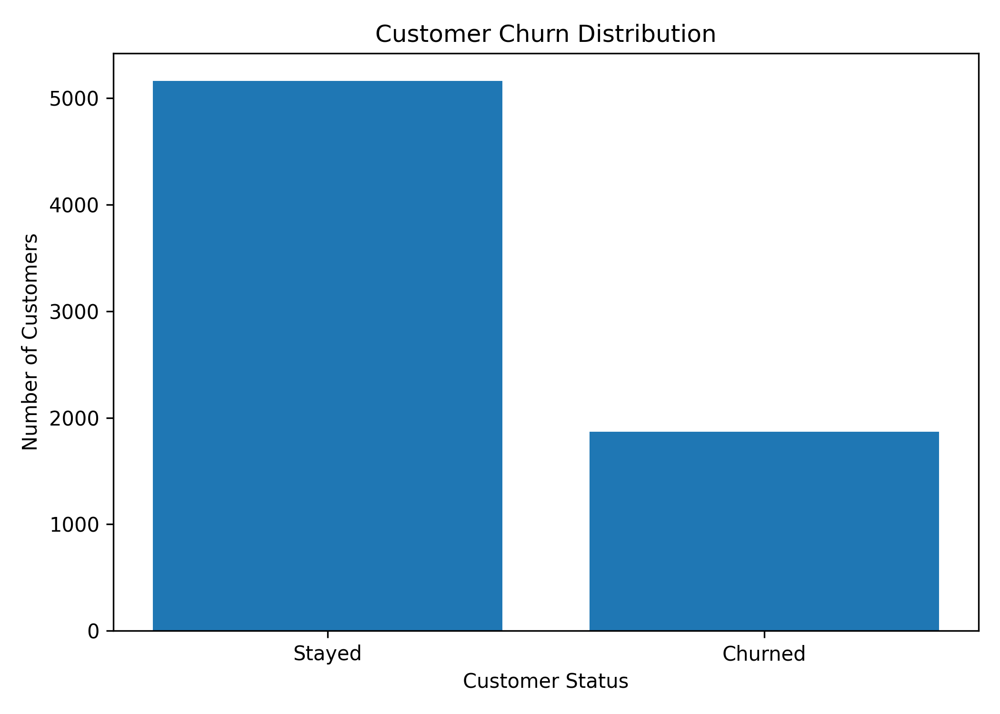
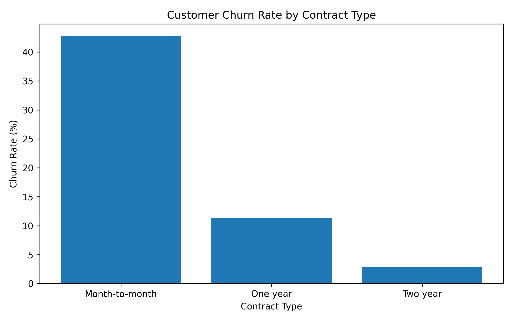
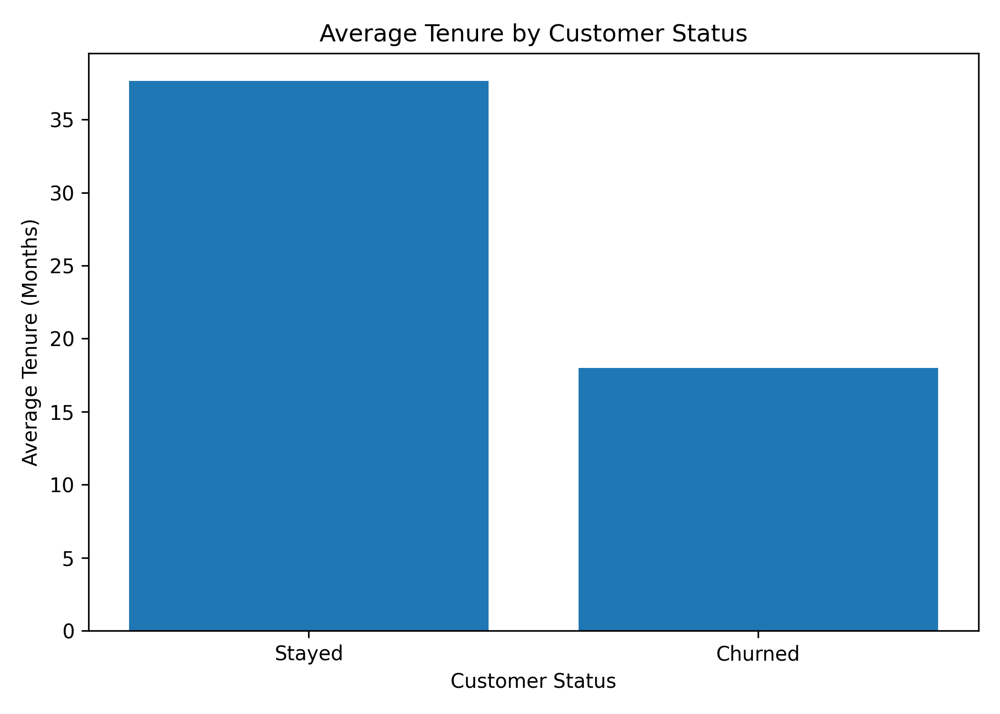
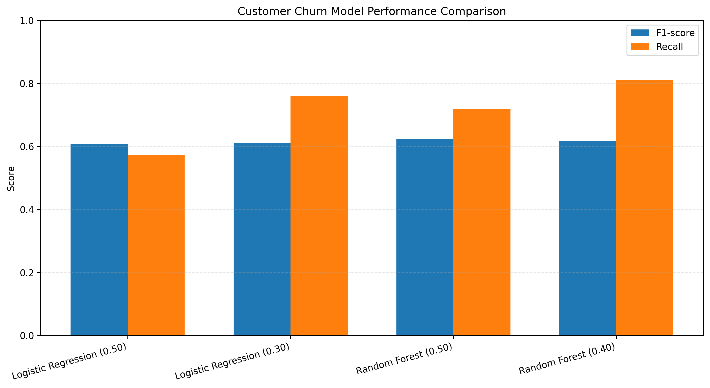

# Customer Churn Prediction

A machine learning project that explores customer churn in the telecommunications industry using Python, exploratory data analysis (EDA), Logistic Regression, and Random Forest.

**Repository:** [Customer Churn Prediction on GitHub](https://github.com/ImashaCheni2003/customer-churn-prediction)

## Table of Contents

- [Project Overview](#project-overview)
- [Objectives](#objectives)
- [Technologies](#technologies)
- [Dataset](#dataset)
- [Key Findings](#key-findings)
- [Exploratory Data Analysis](#exploratory-data-analysis)
- [Machine Learning Models](#machine-learning-models)
- [Model Performance](#model-performance)
- [Getting Started](#getting-started)
- [Project Structure](#project-structure)
- [Future Improvements](#future-improvements)
- [Skills Demonstrated](#skills-demonstrated)

## Project Overview

Customer churn occurs when customers discontinue a company's services. Understanding the patterns associated with churn can help businesses identify customers who may be at risk and develop more informed retention strategies.

This project analyses the IBM Telco Customer Churn dataset, investigates customer behaviour and billing patterns, and compares two classification algorithms for predicting customer churn.

The project also examines how classification thresholds affect the balance between identifying customers who churn and incorrectly flagging customers who stay.

## Objectives

- Clean and prepare customer data for analysis.
- Explore churn patterns across contracts, tenure, billing, and payment methods.
- Build classification models using Logistic Regression and Random Forest.
- Evaluate models using accuracy, precision, recall, F1-score, and ROC-AUC.
- Investigate the impact of classification thresholds on churn detection.
- Communicate findings that may support customer retention decisions.

## Technologies

| Category | Tools |
|---|---|
| Programming language | Python |
| Data analysis | Pandas |
| Data visualisation | Matplotlib |
| Machine learning | Scikit-learn |
| Development environment | Visual Studio Code |
| Version control | Git and GitHub |

## Dataset

The project uses the IBM Telco Customer Churn dataset, containing 7,043 customer records and 21 columns.

During preprocessing, 11 records with blank or invalid `TotalCharges` values were removed, leaving **7,032 records** for analysis.

The target variable is `Churn`:

- `Yes` — the customer left the service.
- `No` — the customer remained with the service.

The dataset contains customer demographics, account information, subscribed services, contract types, and billing details.

## Key Findings

- **Contract type:** Month-to-month customers had an observed churn rate of 42.71%, compared with 11.28% for one-year contracts and 2.85% for two-year contracts.
- **Customer tenure:** Customers who churned had an average tenure of approximately 18 months, compared with 38 months for customers who stayed.
- **Monthly charges:** Customers who churned had average monthly charges of 74.44, compared with 61.31 for customers who stayed, in the dataset's recorded monetary units.
- **Payment method:** Customers using electronic checks had the highest observed churn rate, at 45.29%.

These findings describe associations in the dataset; they do not establish that any particular factor causes customer churn.

## Exploratory Data Analysis

### Customer Churn Distribution



### Churn Rate by Contract Type



### Average Customer Tenure



## Machine Learning Models

Two classification algorithms were evaluated.

**1. Logistic Regression**

Used as a baseline classifier to estimate customer churn probabilities.

**2. Random Forest**

An ensemble classifier configured with 300 trees, a maximum depth of 12, a minimum leaf size of 3, and balanced class weights.

Different classification thresholds were explored to understand how changing the decision boundary affects churn detection and false-positive predictions.

## Model Performance

The following results were recorded across four model and threshold configurations.

| Model | Threshold | Accuracy | Precision | Recall | F1-score | ROC-AUC |
|---|---:|---:|---:|---:|---:|---:|
| Logistic Regression | 0.50 | 80.38% | 64.85% | 57.22% | 60.80% | 83.59% |
| Logistic Regression | 0.30 | 74.27% | 51.08% | 75.94% | 61.08% | 83.59% |
| Random Forest | 0.50 | 76.97% | 55.12% | 71.93% | **62.41%** | 83.07% |
| Random Forest | 0.40 | 73.21% | 49.75% | **81.02%** | 61.65% | 83.07% |

### Model Comparison



### Interpretation

- **Highest accuracy:** Logistic Regression at a threshold of 0.50 achieved 80.38% accuracy.
- **Highest F1-score:** Random Forest at a threshold of 0.50 achieved an F1-score of 62.41% among the four experiments.
- **Highest recall:** Random Forest at a threshold of 0.40 achieved 81.02% recall, identifying 303 of the 374 customers who churned in the test set.
- **Threshold trade-off:** Lower thresholds can identify more potential churners, but may also increase false-positive predictions.

The most appropriate configuration depends on the business objective. For example, a company prioritising the detection of potential churners may prefer higher recall, whereas a company with limited retention resources may place greater emphasis on precision and intervention costs.

**Evaluation limitation:** Multiple model and threshold configurations were evaluated on the same test set. Consequently, these results should be treated as exploratory comparisons rather than an independent final performance estimate. A stronger evaluation would use training and validation data for model selection and threshold tuning, followed by a single evaluation on an untouched test set.

## Getting Started

### Prerequisites

- Python 3.10 or a compatible Python version
- Git

### 1. Clone the repository

```bash
git clone https://github.com/ImashaCheni2003/customer-churn-prediction.git
cd customer-churn-prediction
```

### 2. Create a virtual environment

```powershell
python -m venv .venv
```

Activate it on Windows PowerShell:

```powershell
.\.venv\Scripts\Activate.ps1
```

### 3. Install dependencies

```bash
python -m pip install -r requirements.txt
```

### 4. Run the analysis

```bash
python churn_analysis.py
```

The script performs data preparation, exploratory analysis, model training, threshold experiments, and model evaluation. Generated figures and comparison results are saved under the `reports/` directory.

## Project Structure

```text
customer-churn-prediction/
├── data/
│   └── WA_Fn-UseC_-Telco-Customer-Churn.csv
├── reports/
│   ├── figures/
│   │   ├── average_tenure.png
│   │   ├── churn_by_contract.png
│   │   ├── churn_distribution.png
│   │   └── model_performance_comparison.png
│   └── tables/
│       └── model_comparison.csv
├── churn_analysis.py
├── requirements.txt
├── .gitignore
└── README.md
```

## Future Improvements

- Use cross-validation and a dedicated validation set for model selection.
- Reserve an untouched test set for final evaluation.
- Investigate feature importance and model explainability.
- Explore additional classification algorithms and systematic hyperparameter tuning.
- Evaluate business-oriented costs associated with missed churners and false-positive predictions.
- Develop an interactive application for demonstrating churn predictions.

## Skills Demonstrated

Python programming, data cleaning, exploratory data analysis, data visualisation, feature preprocessing, classification, model evaluation, threshold analysis, and version control with Git and GitHub.

## Disclaimer

This project is intended for educational and portfolio purposes. Model predictions are estimates and should not be interpreted as certain outcomes for individual customers.
